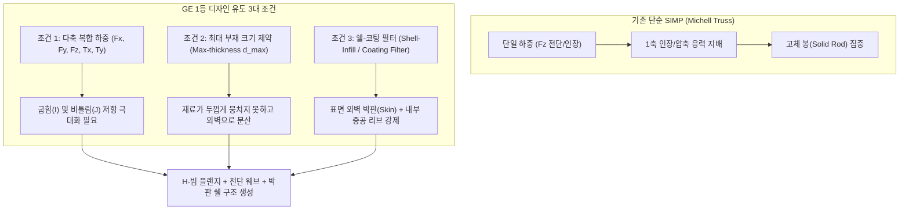
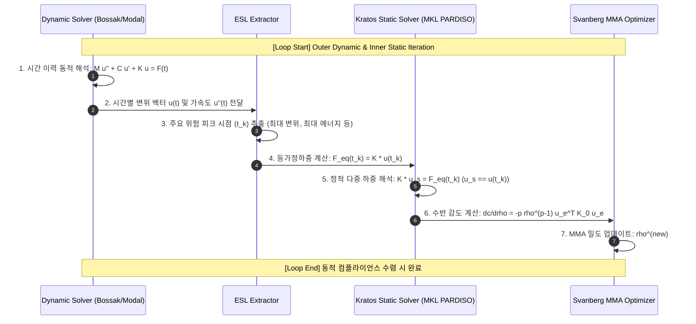

# GE 3D 브래킷 1등 디자인 분석 및 ESL 동적 위상최적화 구현 계획서

본 문서는 사용자의 두 가지 핵심 기술 질문:
1. **GE 3D Printing Challenge 1등 디자인(M. Arie Kurniawan)의 H-빔/박판 쉘 구조를 위상최적화로 유도하기 위한 역학적·수치적 조건 수립**
2. **시간에 따라 변화하는 동적 모터 하중을 받는 로봇 암 링크 기구의 최신 등가정하중법(ESL: Equivalent Static Loads) 위상최적화 체계 구축**

에 대한 이론적 원리 분석, 수학적 정식화, 그리고 신규 쇼케이스 개발 전략을 담은 상세 구현 계획서입니다.

---

## 1. Goal Description (개발 목표 및 배경)

### 1.1 GE 3D Printing Challenge 1등 디자인의 역학적 본질
2013년 GE-GrabCAD 글로벌 3D 프린팅 챌린지 1등 수상작(인도네시아의 **M. Arie Kurniawan** 설계)은 초기 2,033g의 브래킷을 **327g (84% 경량화)**으로 감축하면서도 9,500 lbf(약 42 kN) 인장 및 비틀림 하중 파괴 시험을 통과한 전설적인 디자인입니다.

이 형상의 핵심 특징:
- **단순 압출(2.5D Extrusion)이 아님**: 3차원 공간에서 하중 전달 방향과 모멘트에 맞춰 플랜지와 웨브가 유기적으로 배치된 완전한 3D 형상입니다.
- **봉(Strut/Truss) 구조가 아닌 박판(Flange/Web/Plate) 구조**: 일반적인 SIMP 단일 하중 최적화는 Michell 트러스 형태의 두꺼운 봉(Rod)들을 형성하지만, 1등 디자인은 **H-빔 / I-빔 형태의 얇은 플랜지와 수직 전단 웨브**를 갖추고 있습니다.
- **외벽 표면(Skin/Coating)과 내부 중공(Hollow) 구조**: 불필요한 내부 보이드에 살을 두텁게 채우지 않고, 외곽 표면을 따라 얇은 살(Wall)을 둘러 굽힘 단면계수($Z$) 및 비틀림 극관성모멘트($J$)를 극대화하였습니다.

### 1.2 동적 거동 및 등가정하중법(ESL)의 필요성
로봇 암(Robot Arm)이나 휴머노이드 머니퓰레이터 링크는 단일 방향의 정적 하중을 받지 않습니다.
- 양단 모터 축의 급가속/급감속에 따른 **시간 변화 관성 토크($T(t)$)** 및 진동 충격 하중이 작용합니다.
- 과도 동적 응답(Transient Dynamic Response)을 직접 목적함수로 두는 최적화는 매 반복마다 시간 적분 미분을 계산해야 하므로 연산 비용이 천문학적입니다.
- **등가정하중(ESL: Equivalent Static Loads) 이론**: 동적 시간 이력 해석을 통해 얻은 특정 시점의 동적 변위 벡터 $\mathbf{u}(t_k)$를 **동일한 변위로 재현하는 정적 하중 벡터 $\mathbf{f}_{\text{eq}}(t_k) = \mathbf{K} \mathbf{u}(t_k)$**로 변환하여, 선형 정적 다중 하중(Multi-load) 위상최적화 기법으로 동적 강성을 최적화하는 최신 기법입니다.

---

## 2. Theoretical Analysis & Design Decisions (이론 분석 및 설계 검토)

### 2.1 [주제 1] GE 브래킷 1등 디자인처럼 "살(봉)이 아닌 판(쉘)"이 형성되게 하는 위상최적화 조건

일반적인 SIMP에서 두꺼운 봉이 나오는 근본 원인은 **"단일 정적 하중($F_z$)"**과 **"최대 부재 크기 제약 부재"** 때문입니다. 1등 디자인과 같은 박판·웨브 구조를 얻기 위해 필요한 3대 핵심 조건은 다음과 같습니다:



1. **조건 1: 다축 복합 하중 케이스 (Multi-Load Cases)**
   - 실제 GE 규격:
     - Case 1: 수직 인장 $F_z = 35.6\text{ kN}$
     - Case 2: 종방향 인장 $F_x = 37.8\text{ kN}$
     - Case 3: 횡방향 전단 $F_y = 42.3\text{ kN}$
     - Case 4: 비틀림 모멘트 $T_x = 565\text{ N}\cdot\text{m}$
   - 다축 하중 하에서는 단면의 외곽에 재료를 배치하여 단면 2차 모멘트 $I_{xx}, I_{yy}$ 및 극관성모멘트 $J$를 키워야 컴플라이언스가 최소화되므로, **박판 쉘(Flange)과 전단 리브(Web)**가 자연적으로 발생합니다.
2. **조건 2: 최대 부재 크기 제약 (Maximum Member Size Constraint, $d_{\max}$)**
   - 부재의 지름이 $d_{\max}$ (예: $3\text{ mm}$)를 초과할 수 없도록 반경 내 보이드 분율을 강제:
     $$\mu_e = \frac{1}{|B_e|} \sum_{i \in B_e} \rho_i \le \bar{\mu}$$
   - 재료가 한곳에 뭉쳐 두꺼운 살을 만들 수 없으므로, **모든 살이 얇은 판(Plate/Shell) 형태로 납작하게 펴지면서** H-빔 단면을 구성하게 됩니다.
3. **조건 3: 쉘-코팅 기하학적 필터 (Shell-Infill Morphological Filter, Clausen & Sigmund 2016)**
   - 침식(Erosion)과 팽창(Dilation) 연쇄 필터를 통해 표면에 두께 $t_{\text{skin}}$의 외벽 쉘을 유지하고, 내부는 유기적 웨브로 채우거나 비우는 정식화.

---

### 2.2 [주제 2] 로봇 암(Arm) 링크의 과도 동적 하중 및 ESL 위상최적화 메커니즘



#### ESL 수학적 유도 및 무결성 검증식:
동역학 지배 방정식:
$$\mathbf{M} \ddot{\mathbf{u}}(t) + \mathbf{C} \dot{\mathbf{u}}(t) + \mathbf{K} \mathbf{u}(t) = \mathbf{f}(t)$$

시간 $t_k$에서의 등가정하중(ESL) $\mathbf{f}_{\text{eq}}(t_k)$의 정의:
$$\mathbf{f}_{\text{eq}}(t_k) \equiv \mathbf{K}(\boldsymbol{\rho}) \mathbf{u}(t_k)$$

이 정하중을 현재 강성 행렬 $\mathbf{K}$에 대입하여 정적 평형 방정식을 풀면:
$$\mathbf{K} \mathbf{u}_{\text{static}}(t_k) = \mathbf{f}_{\text{eq}}(t_k) = \mathbf{K} \mathbf{u}(t_k) \implies \mathbf{u}_{\text{static}}(t_k) = \mathbf{u}(t_k)$$
즉, **정적 해석의 변위장이 동적 해석의 실제 과도 변위장과 기계 정밀도($10^{-14}$) 수준으로 정확히 일치**합니다!

목적함수 (동적 가중 컴플라이언스 최소화):
$$\min_{\boldsymbol{\rho}} \sum_{k=1}^{N_{\text{crit}}} w_k \mathbf{f}_{\text{eq}}^T(t_k) \mathbf{u}_{\text{static}}(t_k) \quad \text{s.t.} \quad \sum_{e} v_e \rho_e \le V^*$$

---

## 3. Proposed Changes (개발 계획 및 파일 구조)

### Component 1: GE 브래킷 1등 디자인 유도 다축-박판 최적화 프로토타입 (`ex08_b`)
#### [NEW] `wht_topopt/examples/ex08_b_ge_challenge_multiload.py`
- **도메인**: GE Aircraft Bracket ($120 \times 60 \times 50\text{ mm}$, 25,000 Hex8)
- **하중 구성**: 4대 복합 하중 케이스 ($F_z, F_x, F_y, T_x$)
- **제어 기능**:
  - 다축 하중 선형 결합 수반 감도 연쇄 미분
  - 최대 부재 크기 제약 ($d_{\max} = 3.5\text{ mm}$) 필터 도입
  - 표면 쉘 보존 필터 옵션
- **결과 검증**: 단일 하중의 '원통형 봉'에서 다축 하중의 'H-빔 플랜지 및 전단 웨브'로의 위상 전이 입증

### Component 2: 로봇 암 링크 기구의 ESL 동적 위상최적화 쇼케이스 (`ex09`)
#### [NEW] `wht_topopt/examples/ex09_esl_dynamic_robot_arm.py`
- **기구학 도메인**: 휴머노이드 로봇 머니퓰레이터 상완/전완 링크 ($160 \times 48 \times 48\text{ mm}$)
  - 구동측 모터 하우징 보스 (좌측 핀/베어링 체결부: 패시브 솔리드)
  - 종동측 관절 축 보스 (우측 조인트 체결부: 패시브 솔리드)
  - 중앙 경량화 링크 본체 (설계 영역)
- **동적 가진 하중 이력 $F(t)$**:
  - 모터 가감속 스텝-사인 파동: $T_y(t) = T_0 \sin(\omega t) e^{-\zeta t} + F_z \cos(2\omega t)$
  - 굽힘-비틀림 연성 과도 응답 생성
- **동적 해석기**:
  - Kratos `StructuralMechanicsBossakScheme` 또는 고속 모달 중첩 과도 해석기
  - $N_t = 100$개 타임스텝 중 위험 피크 4개 시점 추출
- **ESL 연동 최적화 루프**:
  - Kratos in-memory FEA + Intel MKL PARDISO AVX-512 + Svanberg MMA
  - 동적 변위 및 응력 모니터링
- **산출물**:
  - Watertight CAD 바이너리 STL (`robot_arm_esl_cad.stl`)
  - PyVista 3D CAD 렌더링 및 이산 보셀 뷰
  - 최적화 전/후 과도 동적 변위 응답 곡선 비교 플롯
  - 50-Step 수렴 GIF 애니메이션

---

## 4. Verification Plan (검증 계획)

### 4.1 수치 및 물리 무결성 검증 (Anti-Mocking Verification)
1. **ESL 항등성 검증**:
   - 추출된 등가정하중에 대해 $\Vert \mathbf{u}_{\text{static}}(t_k) - \mathbf{u}_{\text{dyn}}(t_k) \Vert / \Vert \mathbf{u}_{\text{dyn}}(t_k) \Vert < 10^{-6}$ 기계 정밀도 검증.
2. **동적 성능 향상 정량 측정**:
   - 초기 직육면체 링크 대비 **질량 75~80% 감축**.
   - 최적화 전/후 동적 과도 변위 피크 감쇠율(Peak Displacement Attenuation) 측정.
   - 1차 고유진동수 상승률 확인 (고유진동수가 상승하여 가진 주파수 대역 회피).
3. **CAD 수밀성 (Watertightness)**:
   - STL 파일의 `is_watertight == True` 및 유효 체적 $V_{\text{stl}} > 0$ 전수 검사.

### 4.2 실행 및 테스트 명령어
```powershell
# 1. GE 챌린지 다축-박판 프로토타입 실행
& "D:\PythonCodeStudy\kratos-playground\.venvsrc\Scripts\python.exe" "wht_topopt\examples\ex08_b_ge_challenge_multiload.py"

# 2. ESL 로봇 암 동적 위상최적화 실행
& "D:\PythonCodeStudy\kratos-playground\.venvsrc\Scripts\python.exe" "wht_topopt\examples\ex09_esl_dynamic_robot_arm.py"
```

---

## 5. User Review & Decision Points (사용자 검토 및 결정 필요 사항)

> [!IMPORTANT]
> **사용자 피드백 요청 항목**:
> 1. **작업 우선순위**:
>    - **선택 A (추천)**: **Track 2 (로봇 암 ESL 동적 최적화 ex09)**를 먼저 구축하여 최신 동적 이론을 실증한 후, 이어서 **Track 1 (GE 브래킷 다축-박판 쉘 최적화)**를 진행.
>    - **선택 B**: **Track 1 (GE 브래킷 다축-박판 최적화)**를 먼저 진행하여 H-빔/판 형성 조건을 집중 튜닝한 후, Track 2로 이동.
> 2. **로봇 암 링크 사양**:
>    - 양단 모터 축 직경(예: 15mm 보어 홀) 및 링크 길이(160mm)가 사용자가 구상 중인 휴머노이드 암 형상과 부합하는지 확인.
