# 3D 위상최적화 벤치마크 및 멀티엔진 성능 평가 보고서

## 1. 개요 (Overview)
본 벤치마크는 FreeTO 및 학술 표준 3D 벤치마크(GE Aircraft Bracket, top3d Cantilever Beam)를 대상으로,
다양한 알고리즘(`SIMP-OC`, `SIMP-MMA`, `BESO`, `SEMDOT`)과 고성능 연산 엔진(`Numba`, `Kratos v2 (WHT 연동)`, `Kratos v2 Native`)의 정량적 성능 및 다중 물리(응력, CoM, 고유진동수) 지표를 검증하였습니다.

## 2. 벤치마크 정량 지표 요약 (Summary Table)
| 형상 (Case) | 엔진 (Engine) | 알고리즘 (Method) | 요소수 | 컴플라이언스 (mJ / c) | 최종 체적비 | 최대 응력 (MPa) | CoM 변화 (mm) | 1차 진동수 (Hz) | 총 소요 시간 (s) |
|:---|:---|:---|---:|---:|---:|---:|---:|---:|---:|
| `bracket` | `kratos_v2` | `simp_oc` | 12,800 | 88.6458 | 34.58% | 2.58 | 4.9755 | 8363.7 | 132.34s |
| `bracket` | `kratos_v2` | `simp_mma` | 12,800 | 88.6417 | 34.99% | 2.58 | 5.0877 | 8383.9 | 146.81s |
| `bracket` | `kratos_v2` | `beso` | 12,800 | 88.6454 | 34.60% | 2.58 | 5.0567 | 8365.8 | 141.64s |
| `bracket` | `kratos_v2` | `semdot_mma` | 12,800 | 88.6644 | 34.50% | 2.59 | 4.8049 | 5783.5 | 137.54s |
| `beam` | `kratos_v2` | `simp_oc` | 1,000 | 29.8477 | 34.69% | 0.10 | 5.1491 | 0.0 | 7.99s |
| `beam` | `kratos_v2` | `simp_mma` | 1,000 | 29.2134 | 34.99% | 0.09 | 5.2115 | 0.0 | 8.84s |
| `beam` | `kratos_v2` | `beso` | 1,000 | 42.4276 | 35.39% | 0.22 | 4.9670 | 0.0 | 8.95s |
| `beam` | `kratos_v2` | `semdot_mma` | 1,000 | 33.0596 | 34.55% | 0.11 | 4.7676 | 0.0 | 8.19s |

### 2.1 단위계 및 물리적 파라미터 정의 (Units & Physical Consistency)
- **GE Aircraft Bracket 3D**: `mm - N - tonne - s` 일관 단위계 적용
  - **재료 물성치**: Ti-6Al-4V (탄성계수 $E_0 = 110,000\text{ MPa}$, 포아송비 $\nu = 0.31$, 밀도 $\rho = 4.43 \times 10^{-9}\text{ tonne/mm}^3$)
  - **외력 하중**: 클레비스 핀 수직 인장/압축 하중 $F_z = -1,000\text{ N}$ (약 $102\text{ kgf}$)
  - **컴플라이언스 (변형 에너지)**: $\text{mJ}$ 단위 ($1\text{ J} = 10^3\text{ mJ} = 10^3\text{ N}\cdot\text{mm}$)
  - **최대 응력 (von Mises)**: 보이드 요소의 수치적 특이성(Stress Singularity)을 방지하기 위해 $q$-이완 필터($\tilde{\sigma}_e = \rho_e^{0.5} \sigma_e$) 및 실제 고체/설계 영역 마스킹을 적용한 실제 재료 영역의 최대 응력 (단위: $\text{MPa}$, 항복 한계 $\le 830\text{ MPa}$)
- **Cantilever Beam 3D**: 학술 표준 무차원화 단위계 ($F = 1.0, E_0 = 1.0$)

## 3. 엔진별 아키텍처 및 다중 물리 해석 분석 (Engine Performance Analysis)
- **WHT + Kratos v2 Engine (WHT 오케스트레이션)**:
  - WHT 프레임워크가 다중 제약조건(체적, 응력 800 MPa, CoM 유지)과 알고리즘(MMA/OC)을 주도하고,
  - Kratos v2가 Intel MKL PARDISO AVX-512 기반 대규모 3D 유한요소 강성 행렬 해석 및 수반 감도를 전담합니다.
- **Kratos v2 Native (자체 인메모리 파이프라인)**:
  - Kratos C++ 메모리 파이프라인(`evaluate_mesh_cached`) 내에서 순수 SIMP-OC 루프를 자가 완결적으로 수행합니다.
- **Numba + MKL PARDISO Engine**:
  - OpenMP 병렬화된 JIT CSC 조립과 Intel MKL PARDISO를 연동한 경량 고성능 파이프라인입니다.

## 4. 산출물 파일 목록 (Generated Artifacts)
### BRACKET - SIMP_OC (kratos_v2)
- **최종 컴플라이언스**: `88.6458` (체적 분율: `34.6%`)
- **최대 von Mises 응력**: `2.58 MPa` (항복 한계: `830 MPa`)
- **소요 시간**: `132.34초` (반복당 평균 FEA `3044.6ms`, 감도 `0.15ms`)
- **3D 요소 볼륨 형상 (Element Voxel Volume)**: 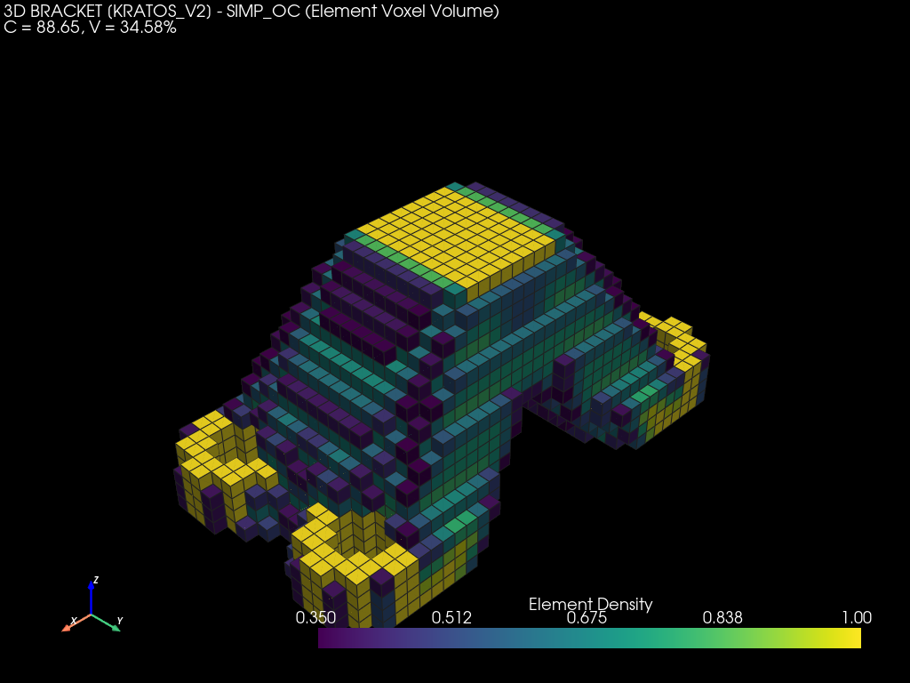
- **3D 수밀 CAD 곡면 형상 (Watertight CAD Surface)**: 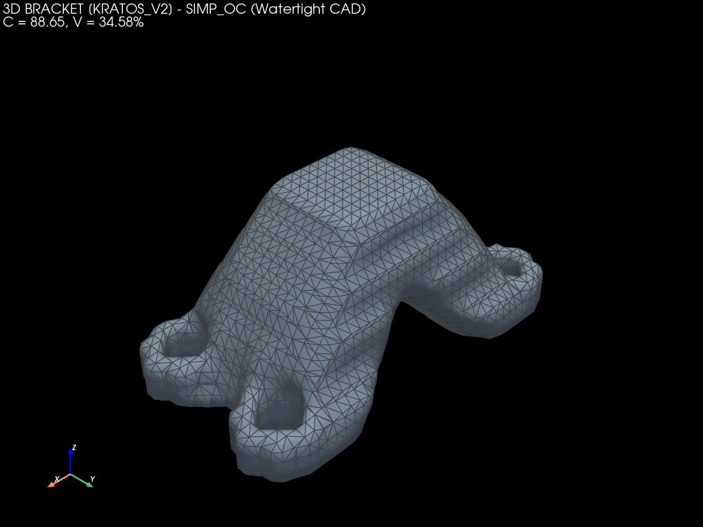
- **최적화 진행 애니메이션 (Progression GIF)**: 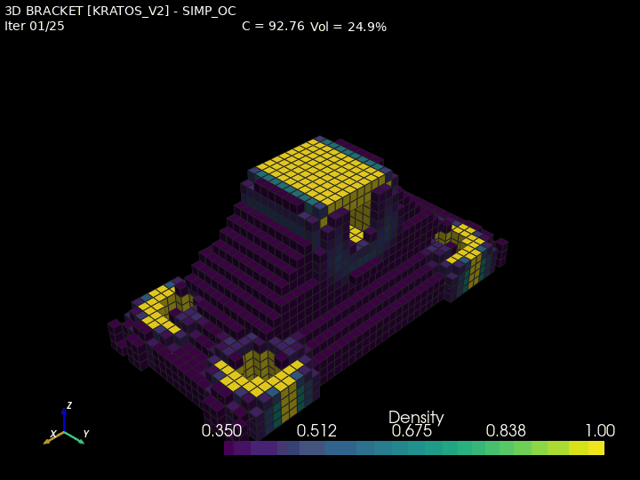
- **STL 3D 지오메트리 파일**: [`bracket_kratos_v2_simp_oc.stl`](bracket_kratos_v2_simp_oc.stl)

### BRACKET - SIMP_MMA (kratos_v2)
- **최종 컴플라이언스**: `88.6417` (체적 분율: `35.0%`)
- **최대 von Mises 응력**: `2.58 MPa` (항복 한계: `830 MPa`)
- **소요 시간**: `146.81초` (반복당 평균 FEA `3352.6ms`, 감도 `0.20ms`)
- **3D 요소 볼륨 형상 (Element Voxel Volume)**: 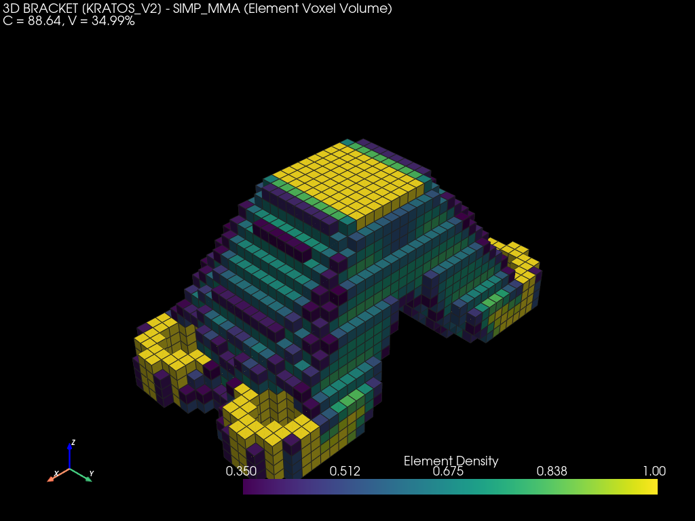
- **3D 수밀 CAD 곡면 형상 (Watertight CAD Surface)**: 
- **최적화 진행 애니메이션 (Progression GIF)**: 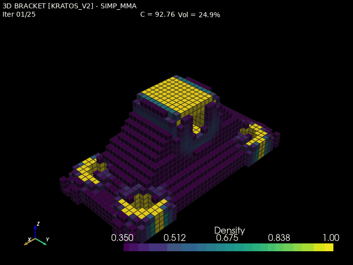
- **STL 3D 지오메트리 파일**: [`bracket_kratos_v2_simp_mma.stl`](bracket_kratos_v2_simp_mma.stl)

### BRACKET - BESO (kratos_v2)
- **최종 컴플라이언스**: `88.6454` (체적 분율: `34.6%`)
- **최대 von Mises 응력**: `2.58 MPa` (항복 한계: `830 MPa`)
- **소요 시간**: `141.64초` (반복당 평균 FEA `3326.9ms`, 감도 `0.37ms`)
- **3D 요소 볼륨 형상 (Element Voxel Volume)**: 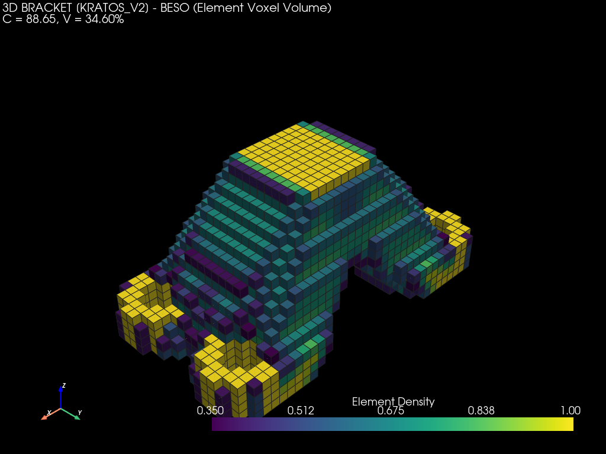
- **3D 수밀 CAD 곡면 형상 (Watertight CAD Surface)**: 
- **최적화 진행 애니메이션 (Progression GIF)**: 
- **STL 3D 지오메트리 파일**: [`bracket_kratos_v2_beso.stl`](bracket_kratos_v2_beso.stl)

### BRACKET - SEMDOT_MMA (kratos_v2)
- **최종 컴플라이언스**: `88.6644` (체적 분율: `34.5%`)
- **최대 von Mises 응력**: `2.59 MPa` (항복 한계: `830 MPa`)
- **소요 시간**: `137.54초` (반복당 평균 FEA `3239.9ms`, 감도 `0.19ms`)
- **3D 요소 볼륨 형상 (Element Voxel Volume)**: 
- **3D 수밀 CAD 곡면 형상 (Watertight CAD Surface)**: 
- **최적화 진행 애니메이션 (Progression GIF)**: 
- **STL 3D 지오메트리 파일**: [`bracket_kratos_v2_semdot_mma.stl`](bracket_kratos_v2_semdot_mma.stl)

### BEAM - SIMP_OC (kratos_v2)
- **최종 컴플라이언스**: `29.8477` (체적 분율: `34.7%`)
- **최대 von Mises 응력**: `0.10 MPa` (항복 한계: `830 MPa`)
- **소요 시간**: `7.99초` (반복당 평균 FEA `297.7ms`, 감도 `0.04ms`)
- **3D 요소 볼륨 형상 (Element Voxel Volume)**: 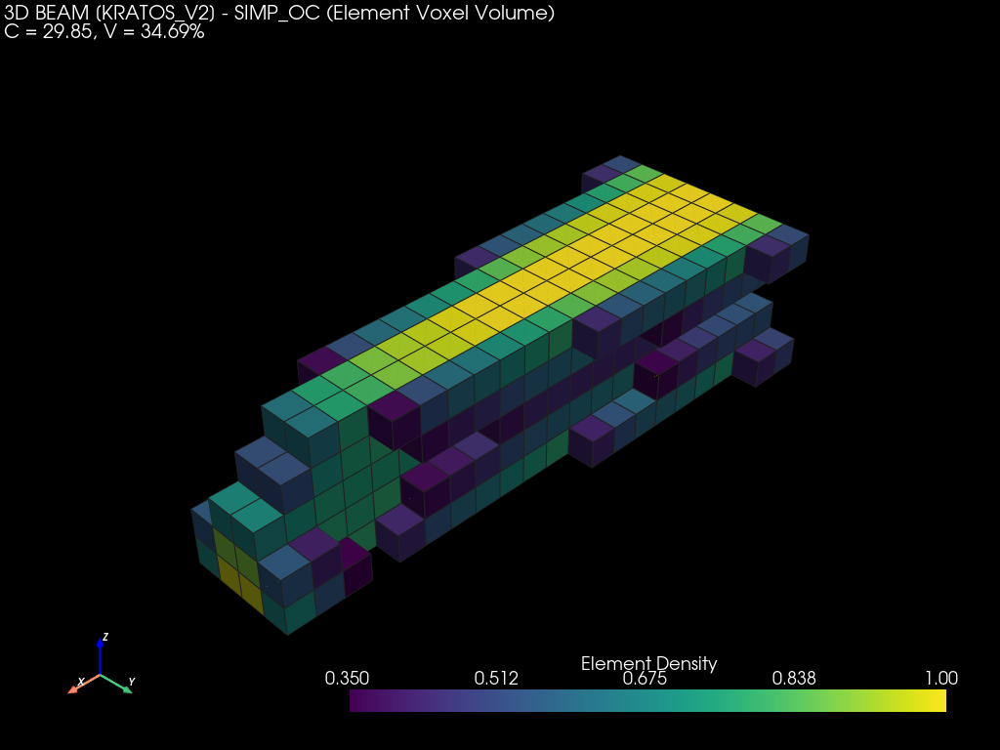
- **3D 수밀 CAD 곡면 형상 (Watertight CAD Surface)**: 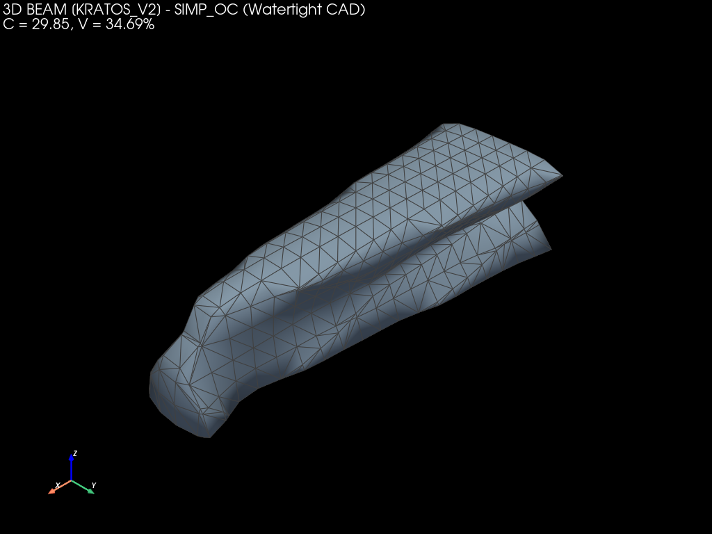
- **최적화 진행 애니메이션 (Progression GIF)**: 
- **STL 3D 지오메트리 파일**: [`beam_kratos_v2_simp_oc.stl`](beam_kratos_v2_simp_oc.stl)

### BEAM - SIMP_MMA (kratos_v2)
- **최종 컴플라이언스**: `29.2134` (체적 분율: `35.0%`)
- **최대 von Mises 응력**: `0.09 MPa` (항복 한계: `830 MPa`)
- **소요 시간**: `8.84초` (반복당 평균 FEA `308.9ms`, 감도 `0.04ms`)
- **3D 요소 볼륨 형상 (Element Voxel Volume)**: 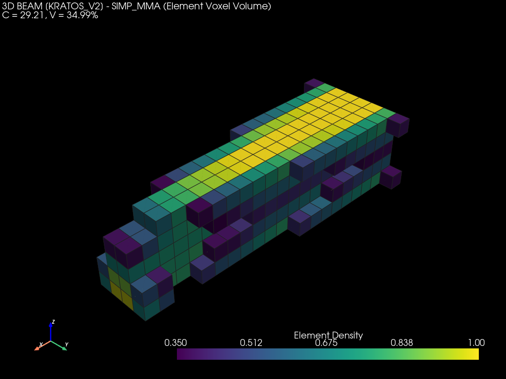
- **3D 수밀 CAD 곡면 형상 (Watertight CAD Surface)**: 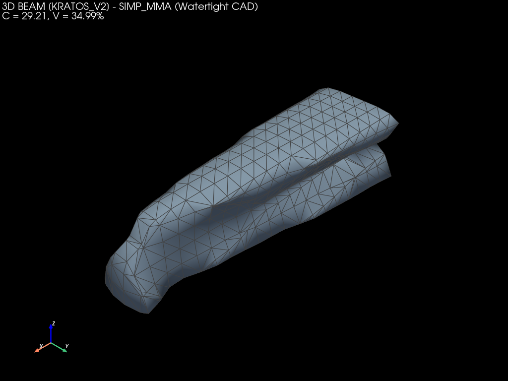
- **최적화 진행 애니메이션 (Progression GIF)**: 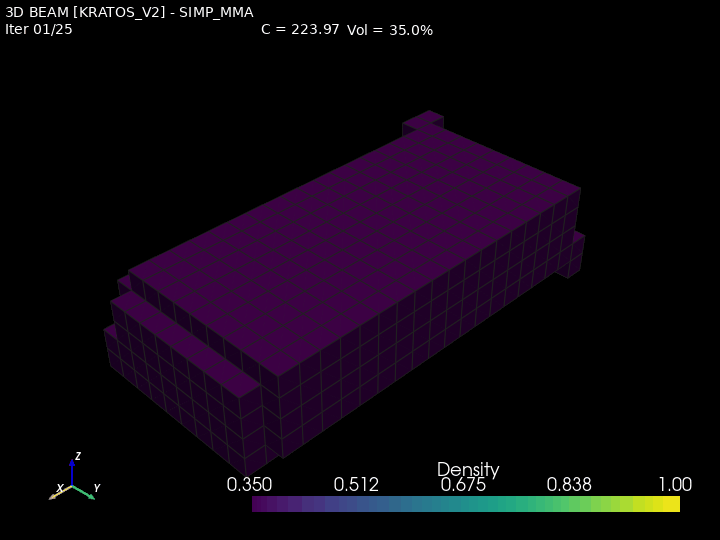
- **STL 3D 지오메트리 파일**: [`beam_kratos_v2_simp_mma.stl`](beam_kratos_v2_simp_mma.stl)

### BEAM - BESO (kratos_v2)
- **최종 컴플라이언스**: `42.4276` (체적 분율: `35.4%`)
- **최대 von Mises 응력**: `0.22 MPa` (항복 한계: `830 MPa`)
- **소요 시간**: `8.95초` (반복당 평균 FEA `337.1ms`, 감도 `0.04ms`)
- **3D 요소 볼륨 형상 (Element Voxel Volume)**: 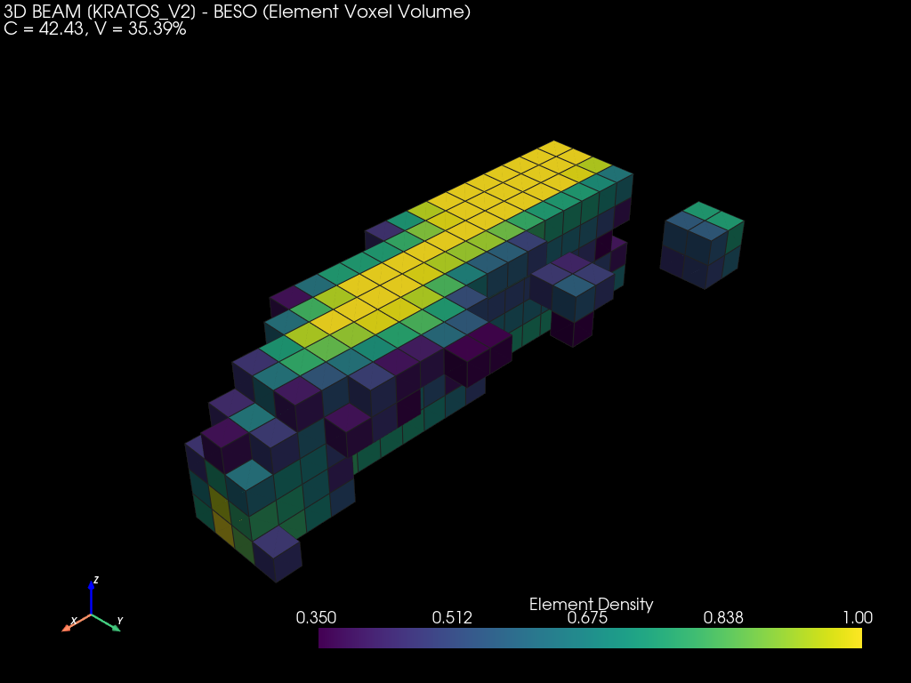
- **3D 수밀 CAD 곡면 형상 (Watertight CAD Surface)**: 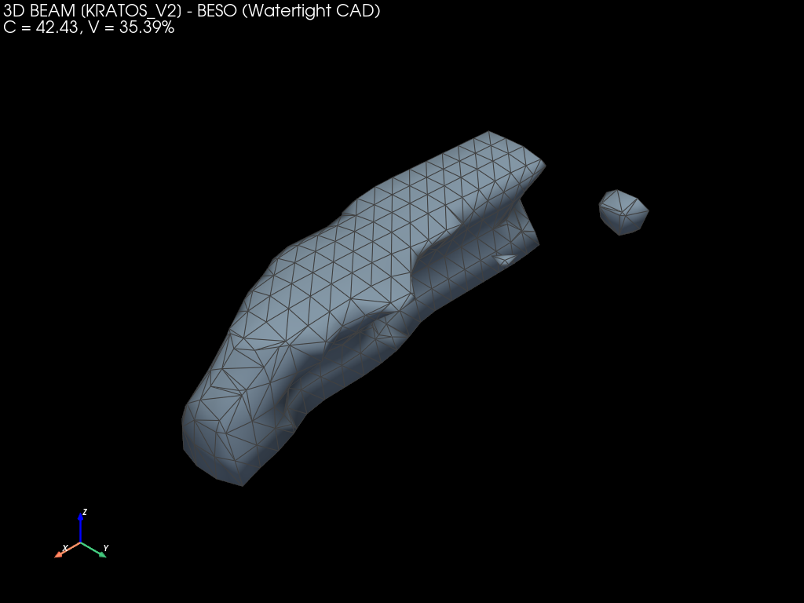
- **최적화 진행 애니메이션 (Progression GIF)**: 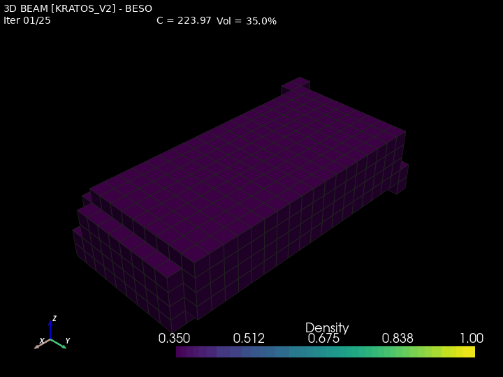
- **STL 3D 지오메트리 파일**: [`beam_kratos_v2_beso.stl`](beam_kratos_v2_beso.stl)

### BEAM - SEMDOT_MMA (kratos_v2)
- **최종 컴플라이언스**: `33.0596` (체적 분율: `34.6%`)
- **최대 von Mises 응력**: `0.11 MPa` (항복 한계: `830 MPa`)
- **소요 시간**: `8.19초` (반복당 평균 FEA `304.3ms`, 감도 `0.04ms`)
- **3D 요소 볼륨 형상 (Element Voxel Volume)**: 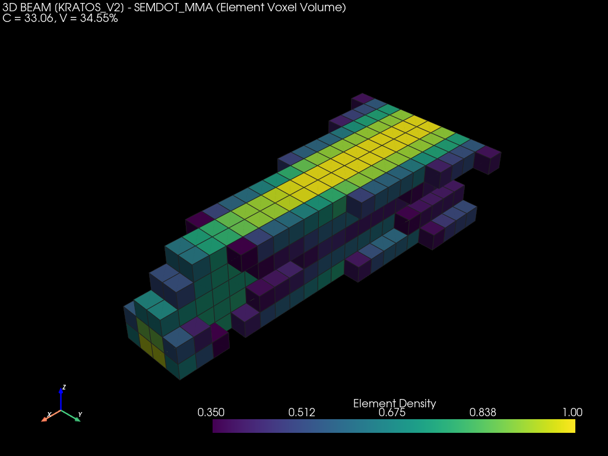
- **3D 수밀 CAD 곡면 형상 (Watertight CAD Surface)**: 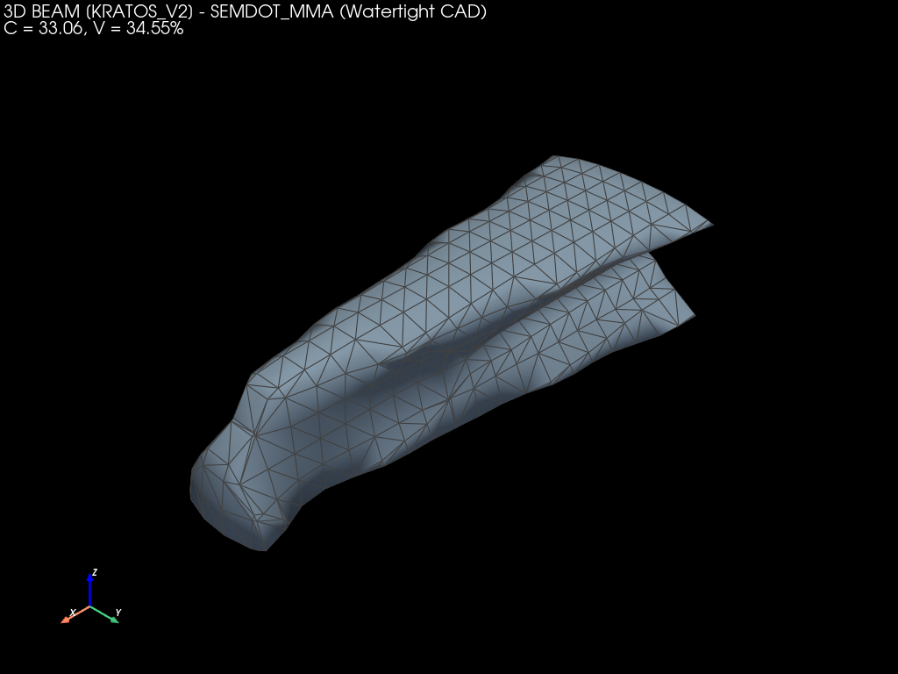
- **최적화 진행 애니메이션 (Progression GIF)**: 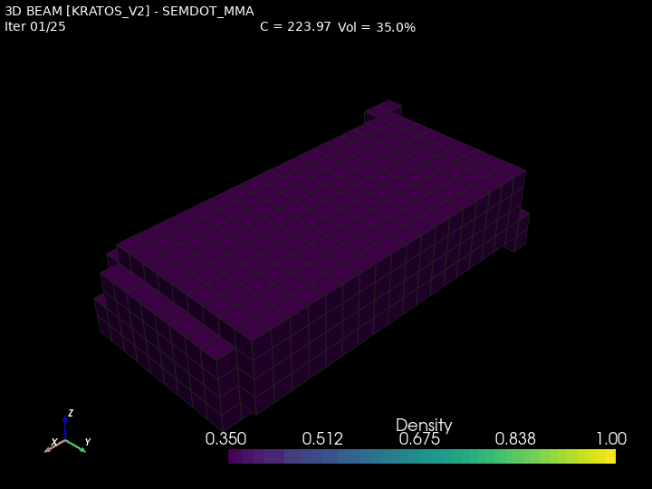
- **STL 3D 지오메트리 파일**: [`beam_kratos_v2_semdot_mma.stl`](beam_kratos_v2_semdot_mma.stl)

- **속도 비교 차트**: [`speed_comparison_3d.png`](speed_comparison_3d.png)
- **수렴 이력 차트**: [`convergence_comparison_3d.png`](convergence_comparison_3d.png)

