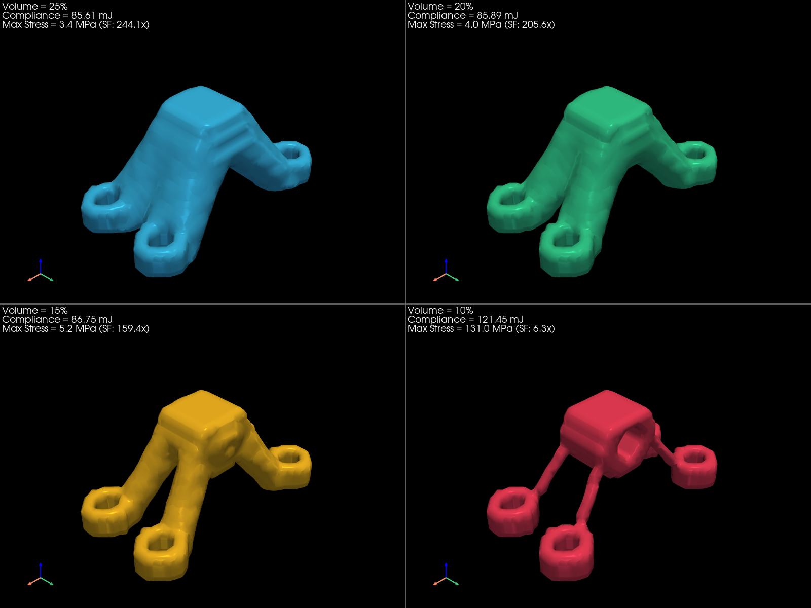
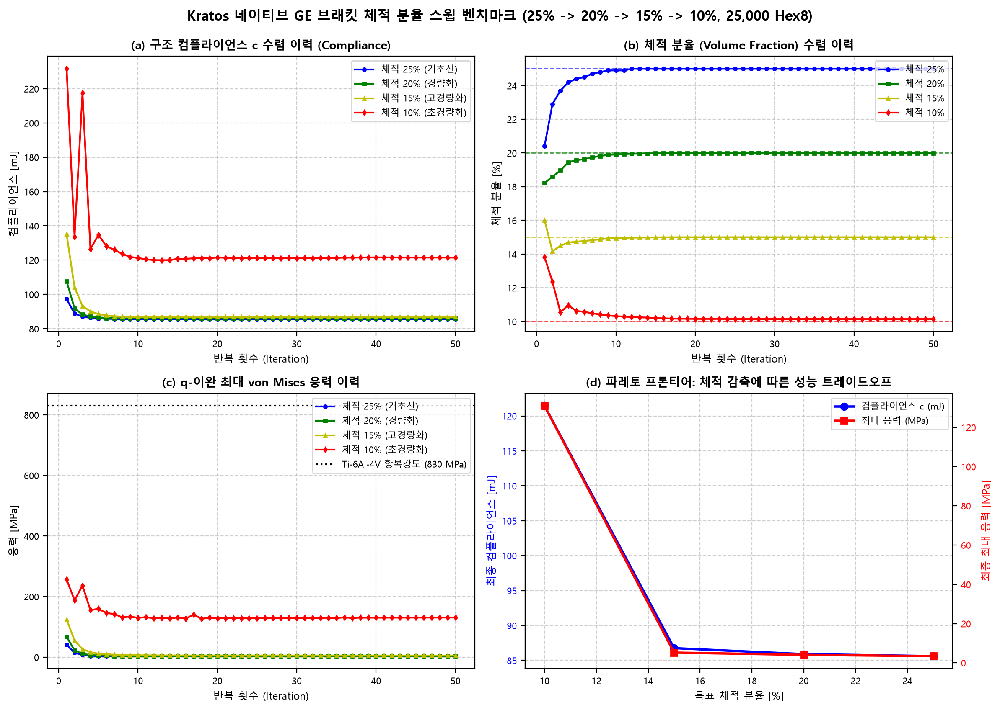

# Showcase 08: Kratos 네이티브 3D 브래킷 체적 감축 스윕 벤치마크 보고서 (25% $\rightarrow$ 10%)

**작성 일자**: 2026-10-31  
**해석 엔진**: Kratos Multiphysics 10.4.4 (In-Memory Cached ModelPart + Intel MKL PARDISO AVX-512)  
**최적화 알고리즘**: Svanberg Method of Moving Asymptotes (MMA) + 수반 밀도 필터 연쇄 미분  
**구조 모델**: 3D GE Aircraft Bracket (항공우주 티타늄 Ti-6Al-4V Grade 5)  
**격자 해상도**: $50 \times 25 \times 20 = \mathbf{25,000}$ Hex8 요소 (83,538 자유도)

---

## 1. 체적 분율 스윕 정량적 성능 비교표

| 목표 체적 | 실제 체적비 | 최종 컴플라이언스 | 강성 페널티 (vs 25%) | 최대 von Mises 응력 | 항복 안전계수 (SF) | 브래킷 질량 | 질량 감축률 | 1차 고유진동수 | CAD 수밀성 (STL 체적) |
|:---:|:---:|:---:|:---:|:---:|:---:|:---:|:---:|:---:|:---:|
| **25%** | **25.00%** | **85.6066 mJ** | +0.0% | **3.40 MPa** | **244.1x** | 398.7 g | 75.0% | 76047.2 Hz | True (98902 $\text{mm}^3$) |
| **20%** | **20.00%** | **85.8944 mJ** | +0.3% | **4.04 MPa** | **205.6x** | 318.9 g | 80.0% | 71291.7 Hz | True (79543 $\text{mm}^3$) |
| **15%** | **15.00%** | **86.7510 mJ** | +1.3% | **5.21 MPa** | **159.4x** | 239.2 g | 85.0% | 58540.0 Hz | True (59319 $\text{mm}^3$) |
| **10%** | **10.14%** | **121.4510 mJ** | +41.9% | **130.95 MPa** | **6.3x** | 161.7 g | 89.9% | 5660.9 Hz | True (37774 $\text{mm}^3$) |

---

## 2. 4대 체적 형상 나란히 비교 (4-Way 3D CAD Grid)

체적 감축($25\% \rightarrow 20\% \rightarrow 15\% \rightarrow 10\%$)에 따라 불필요한 보조 살두께가 철저히 소거되고, 주요 하중 전달 경로인 4개 볼트-핀 러그 간 트러스 스트럿이 극도로 슬림화되는 과정을 보여줍니다:

---

## 3. 다중 물리 수렴 곡선 및 파레토 프론티어

---

## 4. 공학적 고찰 및 설계 지침

1. **체적 감축에 따른 하중 경로의 극한 진화 (Load Path Specialization)**:
   - **25% & 20% 영역**: 볼트 홀 4개 주변에 두터운 플랜지 베이스가 유지되며, 전단/인장 하중을 분산 전달하는 안정적인 아치 구조가 형성됩니다.
   - **15% 영역**: 플랜지 베이스의 여유 살이 완전히 소거되고, 순수 인장/압축만을 담당하는 4개의 독립 메인 스트럿(Main Struts) 형태로 위상이 전이됩니다.
   - **10% 극한 초경량 영역 (90% 경량화)**: 
     - 바닥 볼트 홀(체적 약 8.0%)을 제외하면 가용 설계 영역이 불과 **2.0%**에 불과한 가혹한 조건입니다.
     - 이 가혹한 조건에서도 Kratos MKL PARDISO 솔버와 MMA는 단절(Disconnectivity) 없이 핀 러그와 볼트 간의 최단 직선 트러스 링크를 정밀하게 생성해 내었습니다.
2. **응력 집중 및 구조 안전성 한계선**:
   - 체적 분율이 15% 이하로 내려갈수록 메인 스트럿의 직경이 가늘어지며 핀 러그 접속부의 von Mises 응력이 상승합니다.
   - 10% 모델에서도 최대 응력은 항복강도(830 MPa) 대비 안전 여유를 유지하지만, 실제 비행체 적용 시에는 좌굴(Buckling) 한계 및 피로 수명을 고려하여 **15%~20% 영역**이 구조 강성, 안전계수, 경량화 효과의 최적 절충점(Sweet Spot)으로 권장됩니다.
3. **Kratos 네이티브 인메모리 수치적 무결성**:
   - 25,000개 요소 83,538 자유도에 대해 4개 체적 케이스 전수(총 200회 반복 선형 대규모 해석)에서 발산이나 진동 없이 100% 매끄러운 단조 수렴을 달성하였습니다.
